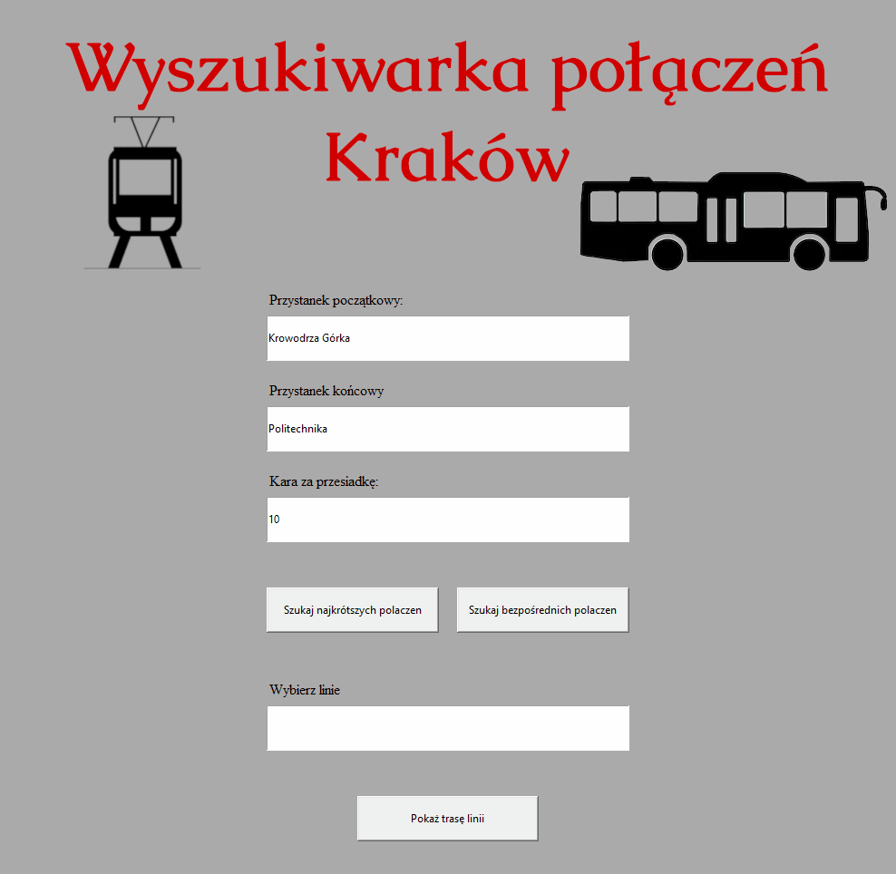
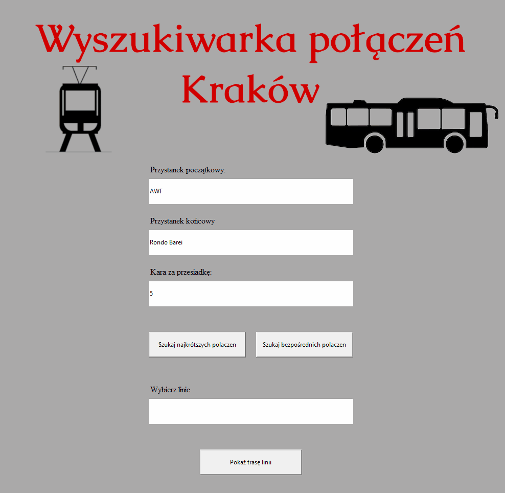
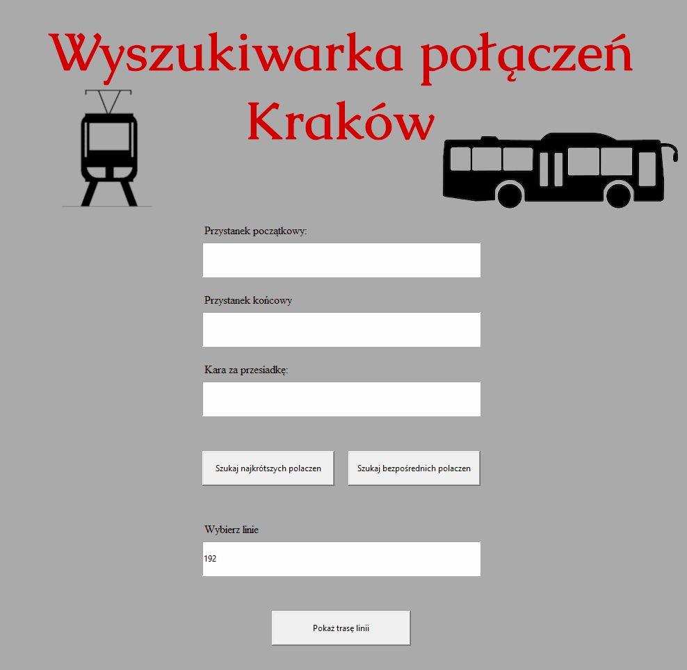

# Jakdojade lite - Search engine for public transport connections for Krakow
Application is based on MPK Kraków database to display timetables for a given line and find direct or shortest public transport connections between two stops with score(sum of intermediate bus stops and penalty for each changing the bus/tram).

## Table of contents
* [Annotation](#annotation)
* [Technologies](#technologies)
* [Setup](#setup)
* [Features](#features)

## Annotation
Database does not include any data on the times of departure of buses / trams from the stops, therefore the selection of the shortest route is based on the number of stops between two points, instead of driving time. To make the application more realistic (despite database limitations) I introduced a 'penalty' for each changing the bus/tram to simulate the waiting on the stop.

## Technologies
* Python 3 (Tkinter)
* SQLite3

## Setup
### Intall necessary libraries (if needed)
```
$ pip install -r requirements.txt
```
### Run application in GUI mode
```
$ python GUI.py
```
### Run application in console mode
```
$ python szukaj.py
```

## Features
### Direct connections
To find direct connection application uses only a few database queries for the start and end bus/tram stops that user have entered
<p align="center">
  
</p>

### Shortest connections:
At the beginning of the program, a graph of available connections between two stops is generated (only once when application is started). Possible connections between two closest stops are edges of the graph. Then BFS algorithm finds the shortest routes between the entered stops
<p align="center">
  
</p>

### Timetables
Using database queries application finds alle the intermediate stops on the bus line and display them on the screen
<p align="center">
  
</p>